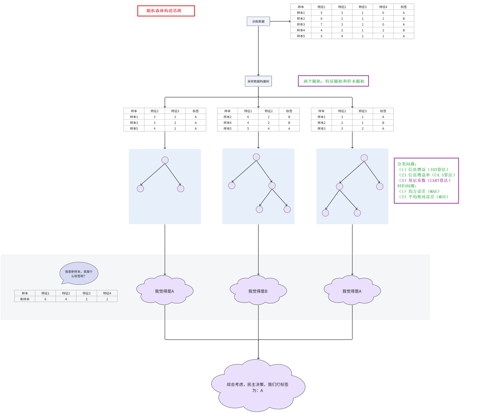

# 随机森林复习

## 随机森林是什么？

随机森林是一种 **集成学习方法（Ensemble Learning）**，具体属于 **Bagging（Bootstrap Aggregating）** 类型。它由 **多棵决策树** 组成，每棵树都是在训练集中抽样构建的，最终的预测结果由这些树“投票”或“平均”决定。

- 如果是**分类问题**：每棵树投票，选票最多的类为最终输出。
- 如果是**回归问题**：取所有树的预测平均值。


## 核心思想

### 随机性来源

随机森林的“随机”体现在两个方面：

- **随机样本**：对原始数据集做有放回的抽样（Bootstrapping），生成不同的数据子集，给每棵树使用。
- **随机特征**：在每次划分节点时，只从特征的一个子集里选择最佳划分，而不是所有特征中找最优的。

两个随机使随机森林算法有了更强的泛化能力。


### 集成学习原理

集成多个弱分类器（单棵决策树）形成一个强分类器。虽然一棵树容易过拟合，但很多不同的树结合起来可以提高稳定性和准确率。


## 工作流程

1、给定训练集 D，构建多个训练子集（如100个），每个通过随机采样产生。

2、对每个子集训练一棵决策树（不剪枝）。

3、在每个树节点选择划分时，仅考虑一部分特征（例如，总特征数的一小部分）。

4、最终预测时：

- 分类：投票多数类
- 回归：取预测平均值




## 优势

1、抗过拟合，泛化能力强

2、能处理高维特征数据

3、对缺失值、异常值不太敏感


## 代码

```python
# 模型训练
clf = RandomForestClassifier(n_estimators=100, random_state=42)
clf.fit(X_train, y_train)
```

