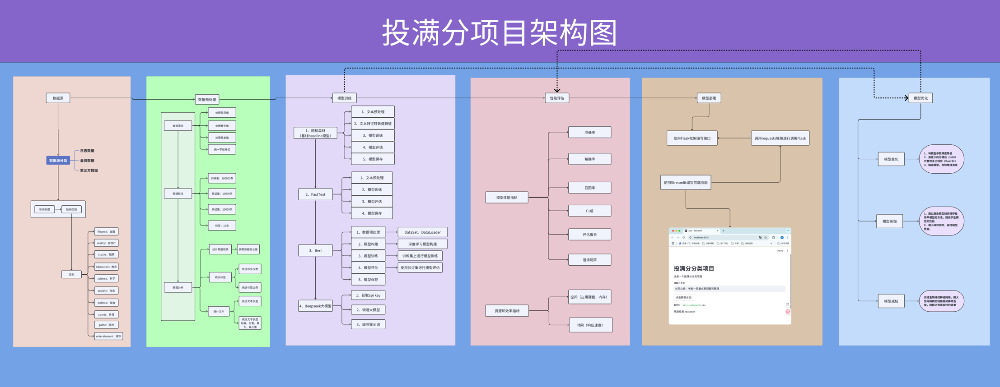
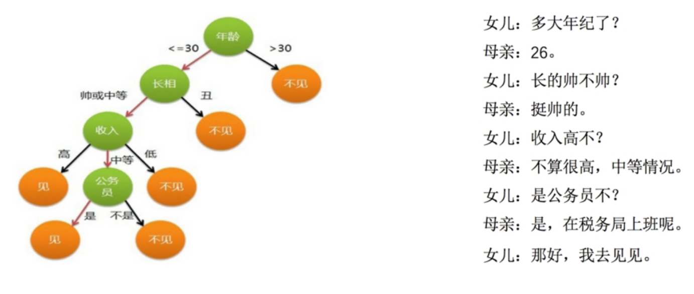
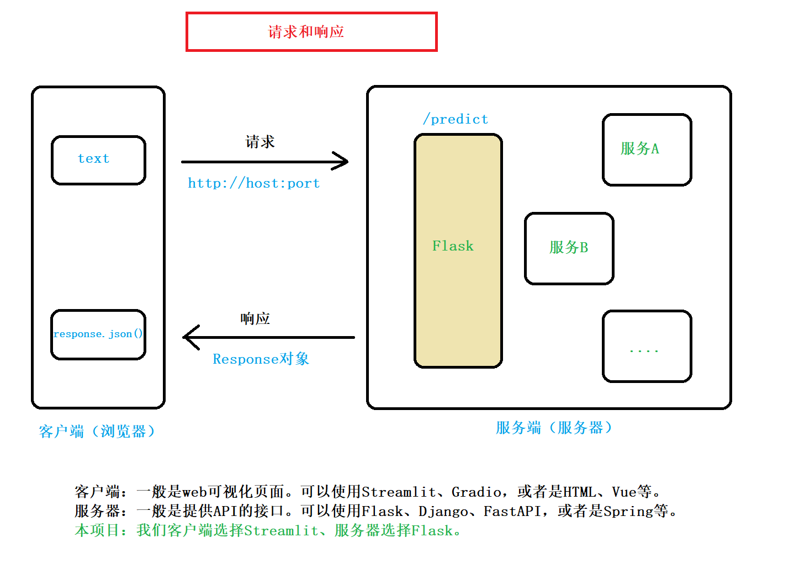
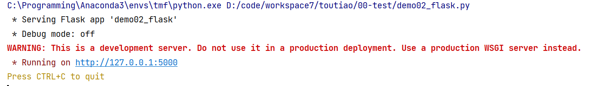
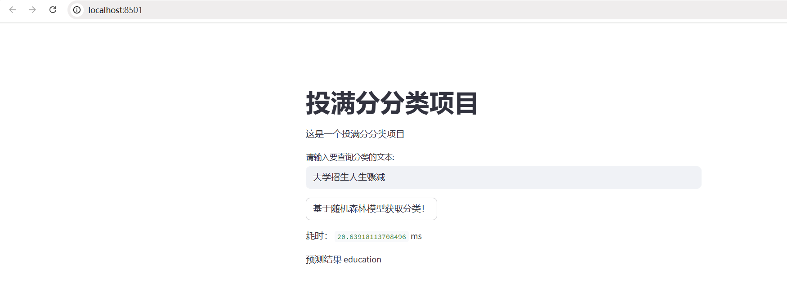
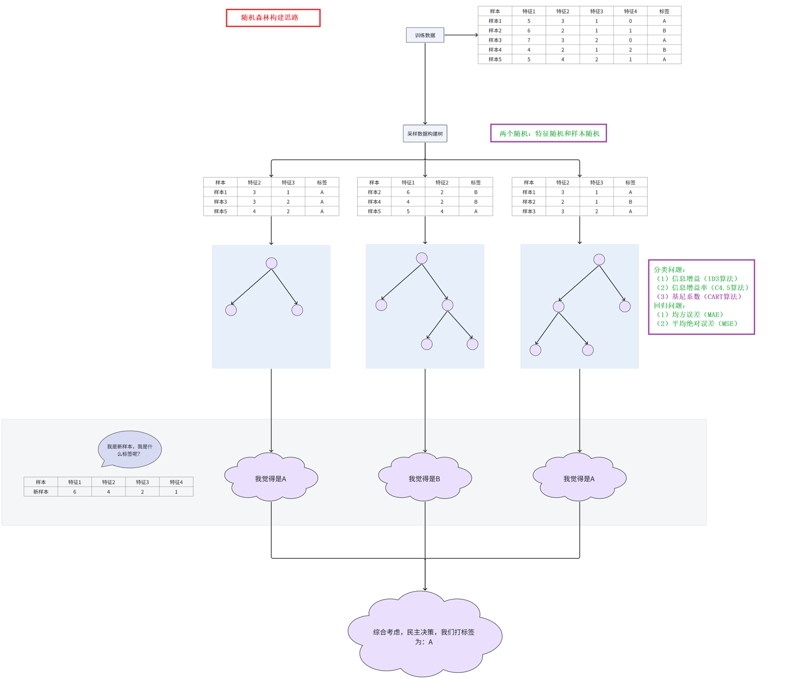

# 投满分项目

## 【了解】今日内容介绍

- 项目介绍
- 数据集说明
- 随机森林-baseline模型

## 【掌握】项目介绍

### 项目和需求的区别

需求：指业务或者是用户的需要，通常是项目的起点。

> 简单理解：老板想干一件事。

项目：将需求转换为现实的执行过程，涉及明确的目标、时间范围、资源分配和交付成果。

> 简单理解：把老板这个需求进行细分，评审一下看哪些能做，哪些不能做，接着规划周期，最后根据计划施工，直至把这件事干完。

### AI项目落地阶段概览

| 阶段               | 目标               | 人员                             | 工作                         |
| ------------------ | ------------------ | -------------------------------- | ---------------------------- |
| 需求分析与项目规划 | 明确业务目标       | 产品经理，项目经理，算法工程师   | 收集需求，制定方案和项目计划 |
| 数据收集与预处理   | 准备高质量的数据   | 数据工程师，算法工程师，标注团队 | 收集数据，清洗数据，标注     |
| 模型设计与训练     | 设计模型           | 算法工程师，研究员               | 选择算法，训练模型，评估效果 |
| 模型优化与测试     | 提升精准度         | 算法工程师，测试工程师           | 优化模型参数，压力测试       |
| 模型部署与集成     | 将模型融入业务系统 | 算法工程师，后端工程师，运维     | 模型转换，API开发            |
| 监控与迭代优化     | 确保模型长期稳定   | 算法工程师，运维，数据工程师     | 监控模型效果，模型定期更新   |

> 温馨提示：
>
> 上线 = 部署

### 项目背景

- 对于字节跳动这家公司来说, 产品线是比较多的，但其中抖音, 今日头条是最大的两个王牌. 分别代表了基于短视频的推荐, 和基于短文本的推荐. 背后融合了众多CV, NLP, 推荐系统, 大数据等领域技术, 可以说是人工智能时代的各类技术的集大成者.

---

- 针对于今日头条来说, 用户在众多新闻中, 一定有更感兴趣的类别. 比如男生的历史, 军事, 足球等, 女生的财经, 八卦, 美妆等. 如果能将用户更感兴趣的类别新闻主动筛选出来, 并进行推荐阅读, 那么点击量, 订阅量, 付费量都会有明显增长。

---

- 基于上述业务需求背景, 字节内部在今日头条app的推荐系统模块中, 需要内嵌一个子任务: 将短文本自动进行多分类, 然后像快递一样的"投递"到对应的"频道"中, 因此"投满分项目"应运而生。

https://jobs.bytedance.com/experienced/product

### 项目架构



## 【实现】数据集

### 数据集介绍

#### 数据类型

- 业务数据：公司业务流程生成的数据，是核心数据。通常是结构化数据，存储在数据库。
- 日志数据：应用程序自动纪录的事件数据。通常是非结构化，半结构化数据，存储形式一般为文本。
- 第三方数据：外部合伙伙伴，公开数据集，或者API接口数据。非公司内部生成，格式多样，参差不齐。

#### 项目类型

- 内部项目：自己公司内部的项目。需求来自于自己公司。
- 外包项目：给其他公司做的项目。需求来自于其他公司（甲方）。

#### 投满分项目数据集

```shell
# 标签
class.txt 为标签文件，包含10个类别标签, 每行一个标签, 为英文单词的展示格式.

# 训练集
train.txt 为18w条样本，10个类别，每个类别是1.8w。每行包括两列, 第一列为文本, 第二列是标签, 中间用\t作为分隔符.

# 测试集
test.txt 为1w条样本，每行包括两列, 第一列为文本, 第二列是标签, 中间用\t作为分隔符.

# 验证集
dev.txt 为1w条样本，每行包括两列, 第一列为文本, 第二列是标签, 中间用\t作为分隔符.
```

### 数据集分析

#### 项目环境

```shell
#1.创建环境
conda create -n tmf python=3.10.8

#2.切换环境
conda activate tmf

#3.安装依赖（依赖文件保存在课程预习资料下）
pip install -r requirements.txt -i https://pypi.tuna.tsinghua.edu.cn/simple

#3.删除环境
conda env remove -n tmf
```

#### 代码实现

EDA：探索性数据分析（Exploratory Data Analysis）

自己在做B项目的时候，数据源可以是外部数据（hugging face、kaggle、modelscope），也可以是大模型生成的数据（质量高）。

`config.py`配置文件：

在我们进入数据分析或者模型构建，通常我们会先实现一个配置文件config.py，方便我们对一些文件数据路径管理。这种方式在实际的生产环境中，非常常见，而不是直接将路径硬编码到我们的代码中。所以当我们拿到项目时候，先查看配置文件，并切换为自己对应的路径。目的：方便我们的管理以及维护。

代码如下：

```python
class Config:
    def __init__(self):
        self.root_path = r'D:\code\workspace7\toutiao/'
        self.train_path = self.root_path + '01-data/train.txt'
        self.dev_path = self.root_path + '01-data/dev.txt'
        self.test_path = self.root_path + '01-data/test.txt'


if __name__ == '__main__':
    # 测试配置文件
    config = Config()
    # 打印参数路径
    print(config.train_path)
    print(config.dev_path)
    print(config.test_path)
```

`dataEDA.py`文件：

主要为对实际对数据，例如train.txt、test.tx或者相关数据文件的分析代码实现。前面我们整体已经知道train.txt主要为两列，一列是文本，一列是标签。我们可以分析以下指标：

> 相关数据量
>
> train.txt的类别样本是否均衡，类别占比情况
>
> 样本的文本大概是怎样的

代码如下：

```python
from collections import Counter
import pandas as pd
from config import Config

# 创建配置对象，获取配置参数
config = Config()

def data_eda(path):
    # todo 第一步：读取数据并查看基本信息
    df_data = pd.read_csv(path, sep='\t', header=None, names=['text', 'label'])
    # 打印前10行
    print(df_data.head(10))
    # 总数据量
    print(len(df_data))

    # todo 第二步：统计标签分布
    counter = Counter(df_data['label'])  # 示例:Counter([1,2,2,1,3,2,2])->Counter({2: 4, 1: 2, 3: 1})
    print(counter)
    # 打印
    for key, value in counter.items():
        print(key, value)

    # todo 第三步：计算标签比例
    all_count = len(df_data)  # 总次数
    for key, value in counter.items():  # key是标签  value是该标签出现的次数
        print(f"总量:{all_count}，标签{key}出现次数:{value}，标签{key}占比：{value / all_count:.2%}")

    # todo 第四步：分析文本长度
    # apply()依次对每个元素执行函数操作: 获取每行文本长度,作为一个新列拼接到原有数据中
    df_data['text_length'] = df_data['text'].apply(lambda x: len(x))
    print(df_data.head(10))
    # 查看新闻标题长度的分布情况
    print(df_data['text_length'].describe())
    print("\n文本长度统计：")
    print(f"平均长度：{df_data['text_length'].mean():.2f} 字符")  # 平均值
    print(f"长度标准差：{df_data['text_length'].std():.2f} 字符")  # 标准差
    print(f"最大长度：{df_data['text_length'].max()} 字符")  # 最大值
    print(f"最小长度：{df_data['text_length'].min()} 字符")  # 最小值


if __name__ == '__main__':
    # 获取训练集路径
    data_eda(config.train_path)
    # data_eda(config.dev_path)
    # data_eda(config.test_path)
```

## 【实现】随机森林模型

在本项目中，我们使用随机森林跑baseline模型（当然你也可以使用其他模型）。

### 为什么要做baseline

- 快速验证任务可行性：基线模型通常简单高效，能够快速验证数据和任务的可行性，为后续优化提供方向。
- 提供性能参考：基线模型的性能为后续复杂模型（如深度学习模型）提供对比基准，衡量改进效果。
- 降低开发成本：基线模型实现简单，能在资源有限的情况下快速构建一个可用的解决方案。
- 发现问题：通过基线模型的训练和评估，可以发现潜在的一些问题，例如数据质量问题。

### 集成学习

机器学习中算法分类如下：

```shell
#1.有监督学习：有特征，有标签
分类问题：标签值是离散的（能够数清楚），新闻分类
代表算法：KNN、决策树、逻辑回归、集成学习

回归问题：标签值是连续的（数不清楚），房价预测
代表算法：线性回归

#2.无监督学习
聚类算法：物以类聚，人以群分
代表算法：KMeans

#3.半监督学习
有部分有标签，有部分没有标签。
目的：提升数据标注的效率，降低成本。

#4.强化学习
不涉及。
```

决策树：是一种使用树形结构来进行分类算法的一种模型。



决策树弊端：容易过拟合。

解决方式：

```shell
# 对于单棵树
剪枝（园艺工程师）

# 引入多棵树
集成学习
```

集成学习的现实比喻：三个臭皮匠，顶个诸葛亮。

集成学习：把多个弱学习器（基学习器）组合成一个更强大的强学习器。

大白话解释：集成学习的弱学习器，就是一颗决策树，默认是CART树（分类和回归树）。

思想分类：

```shell
# Bagging思想
1.随机抽样（有放回）
2.并行训练
3.平权投票（少数服从多数）

# Boosting思想
1.全部样本
2.串行训练
3.加权投票
```

### 模型构建流程

```shell
#1.对数据train.txt等相关文件的文本列进行 分词处理， 得到words列。

#2.采用TF-IDF将words列，转换为数值特征
transfer = StandardScaler()
# 训练
transfer.fit_transform(x_train)
# 预测
transfer.transform(x_test)

tf_idf = TfidfVectorizer()
# 训练
tf_idf.fit_transform(x_train)
# 预测
tf_idf.transform(x_test)

#3.利用随机森林算法进行建模、评估与保存。
# KNN
model = KNeighborClassifier()
model.fit(x_train, y_train)
# 随机森林
model = RandomForestClassifier()
mode.fit(x_train, y_train)

#4.模型预测
model.predict(x_test)

#5.模型部署，提供api接口

#6.前端预测实现
```

### 代码实现

#### 配置

作用：全局统一配置参数，方便管理。

```python
class Config:
    def __init__(self):
        self.root_path = r'D:\code\workspace7\toutiao/'
        # 原始数据路径
        self.train_datapath = self.root_path + '01-data/train.txt'
        self.test_datapath = self.root_path + '01-data/test.txt'
        self.dev_datapath = self.root_path + '01-data/dev.txt'
        # 类别文档
        self.class_doc_path = self.root_path + "01-data/class.txt"
        # 停用词路径
        self.stop_words_path = self.root_path + "01-data/stopwords.txt"

        # 处理后的数据路径
        self.process_train_datapath = self.root_path + "02-rf/final_data/train_process.txt"
        self.process_test_datapath = self.root_path + "02-rf/final_data/test_process.txt"
        self.process_dev_datapath = self.root_path + "02-rf/final_data/dev_process.txt"


        # 保存模型路径
        self.rf_model_save_path = self.root_path + r"02-rf/save_model/rf_model.pkl"
        self.tfidf_model_save_path = self.root_path + r"02-rf/save_model/tfidf_model.pkl"
        # 模型预测结果
        self.model_predict_result = self.root_path + r"02-rf/result/predict_result1.txt"


if __name__ == '__main__':
    config = Config()
    print(config.train_datapath)
```

#### 数据预处理

作用：把数据处理成满足模型要求的格式。

```python
import jieba
import pandas as pd
from config import Config

# 加载配置类对象
config = Config()


def process_data(datapath, processed_datapath):
    # 读取数据,指定列名为text和label
    df_data = pd.read_csv(datapath, sep='\t', header=None, names=['text', 'label'])
    print('df_data-->', df_data.head())

    # 进行分词预处理
    # 把结巴分词拼接后结果作为新列拼接原数据集,最后保存
    # 其中apply功能是: 对输入文本进行结巴分词，获取前30个词并用空格连接
    df_data['words'] = df_data['text'].apply(lambda x: " ".join(jieba.lcut(x)[:30]))
    print(df_data.head())

    # 保存数据
    df_data.to_csv(processed_datapath, sep='\t', index=False, header=True)


if __name__ == '__main__':
    # 保存处理后训练数据
    process_data(config.train_datapath, config.process_train_datapath)
    # 保存处理后测试数据
    process_data(config.test_datapath, config.process_test_datapath)
    # 保存处理后验证数据
    process_data(config.dev_datapath, config.process_dev_datapath)

```

#### 模型训练

TF-IDF：是一种将文本转化为数值向量的向量化方法。

它由两部分组成，TF 和 IDF：

- TF 为term frequency,即词频。衡量一个词在一篇文章里出现的频率（出现的次数除以文章总词数）。
- 逆文档频率（inverse document frequency）：IDF 用来衡量一个词在所有文章中的“独特性”。如果一个词只在少数文章中出现（很罕见），它就更能代表这些文章的特殊内容，IDF 分数高，说明它很重要；如果一个词几乎每篇文章都有（很常见），它对区分文章内容没太大帮助，IDF 分数低，说明它不重要。

TF-IDF 是一种统计方法，用以评估一字词对于一个文件集或一个语料库中的其中一份文件的重要程度。字词的重要性随着它在文件中出现的次数的增加成正比增加，但同时会随着它在语料库中出现的频率成反比下降。

TF-IDF 的主要思想是：如果某个单词在一篇文章中出现的频率 TF 高，并且在其他文章中很少出现，则认为此词或者短语具有很好的类别区分能力，适合用来分类。

案例：演示TF-IDF

```python
from sklearn.feature_extraction.text import TfidfVectorizer


# 测试sklearn的tf-idf
def dm01():
    # 情况一：英文文本语料
    # corpus = [
    #     'I love you.',
    #     'You love him!',
    #     'He is a gay!'
    # ]
    # 情况二：中文文本语料（字）
    corpus = [
        '我 爱 你.',
        '你 爱 他!',
        '他 是 同 性 恋!'
    ]
    # 情况三：中文文本语料（词语）
    # corpus = [
    #     '我 爱 你.',
    #     '你 爱 他!',
    #     '他 是 同性恋!'
    # ]
    # 创建TF-IDF对象
    # token_pattern：正则表达式，用于分词
    # (?u)：启用Unicode模式，能处理非ASCII字符字符，比如中文等
    # \b：单词边界
    # \w：匹配一个字符（大小写字母，数字，下划线）
    # \w+：匹配一个或者多个字符
    vectorizer = TfidfVectorizer(token_pattern=r'(?u)\b\w+\b')
    # 对文本进行tf-idf处理
    X = vectorizer.fit_transform(corpus)
    # 查看处理后的结果，即：特征词（词表）
    features = vectorizer.get_feature_names_out()
    print("features-->", features)
    # 稀疏矩阵
    print("X-->", X)
    # 稠密矩阵
    print("X-->", X.toarray())


if __name__ == '__main__':
    dm01()

```

有了TF-IDF的基础后，下面进入到模型训练的代码：

```python
import pandas as pd
import pickle
from sklearn.feature_extraction.text import TfidfVectorizer
from sklearn.model_selection import train_test_split
from tqdm import tqdm
from sklearn.ensemble import RandomForestClassifier
from sklearn.metrics import accuracy_score, precision_score, recall_score, f1_score, classification_report
# 从sklearn.metrics中导入混淆矩阵包
from sklearn.metrics import confusion_matrix
from config import Config
# 配置对象
conf = Config()


def model2train():
    # 读取训练数据集
    df_data = pd.read_csv(conf.process_train_datapath, sep='\t')[:20000]
    words = df_data["words"]
    labels = df_data["label"]

    # 读取停用词
    # stopwords = open(conf.stop_words_path,encoding='utf-8').read().split()
    stop_words = [line.strip() for line in open(conf.stop_words_path, encoding='utf-8').readlines()]
    # print(stop_words)
    # 创建TfidfVectorizer
    tfidf = TfidfVectorizer(stop_words=stop_words)
    # 将文本转为词频矩阵
    features = tfidf.fit_transform(words)

    # 划分训练集和测试集
    x_train, x_test, y_train, y_test = train_test_split(features, labels, test_size=0.2, random_state=28)
    # 训练模型
    rf = RandomForestClassifier()
    print("开始训练模型...")
    rf.fit(x_train, y_train)
    # 模型预测
    print("开始模型预测和评估...")
    y_pred = rf.predict(x_test)
    # 模型评估
    print("模型评估结果如下:")
    print("准确率：", accuracy_score(y_test, y_pred))
    print("精确率：", precision_score(y_test, y_pred, average='macro'))
    print("召回率：", recall_score(y_test, y_pred, average='macro'))
    print("F1值：", f1_score(y_test, y_pred, average='macro'))

    print("开始保存模型和向量化器...")
    # 保存模型
    with open(conf.rf_model_save_path, 'wb') as f:
        pickle.dump(rf, f)
    print("模型已保存")

    # 保存向量化器
    with open(conf.tfidf_model_save_path, 'wb') as f:
        pickle.dump(tfidf, f)
    print("向量化器已保存")


if __name__ == '__main__':
    model2train()

```

> 模型准确率：82%左右

#### 模型预测（评估）

这里的评估是使用dev数据集的所有数据对模型做一个整体的评估。并非是一条样本一条样本地预测。

```python
import pandas as pd
import pickle
from sklearn.metrics import accuracy_score, precision_score, recall_score, f1_score, classification_report
from config import Config
# 加载配置
config = Config()
# 忽略警告信息
import warnings
warnings.filterwarnings('ignore')


def model2predict():
    # 加载模型和向量化器
    with open(config.rf_model_save_path, 'rb') as f:
        rf = pickle.load(f)
    with open(config.tfidf_model_save_path, 'rb') as f:
        tfidf = pickle.load(f)

    # 读取dev数据集
    df_data = pd.read_csv(config.process_dev_datapath, sep='\t')
    words = df_data["words"]

    # 通过tf-idf进行向量化
    features = tfidf.transform(words)

    # 预测
    y_pred = rf.predict(features)
    # 打印准确率，精确率，召回率，F1值
    print("准确率：", accuracy_score(df_data["label"], y_pred))
    print("精确率：", precision_score(df_data["label"], y_pred, average='macro'))
    print("召回率：", recall_score(df_data["label"], y_pred, average='macro'))
    print("F1值：", f1_score(df_data["label"], y_pred, average='macro'))
    # 打印评估报告
    print(classification_report(df_data["label"], y_pred))

    # 保存结果
    df_data["pred_label"] = y_pred
    df_data.to_csv(config.model_predict_result, sep='\t', index=False)


if __name__ == '__main__':
    model2predict()
```

> 模型准确率：83%左右。

#### 模型部署-服务端

##### 模型部署介绍

模型部署：指将训练好的机器学习或深度学习模型从开发环境转移到生产环境，使其能够处理实际数据并提供预测或分析服务的过程。

这个过程，一般也称为上线。

##### 部署方式说明

云主机：购买云服务器，可以省去自建机房，运维等成本。模型部署到云厂商提供的服务器上。（服务器不是自己的，类似于租赁）

物理机：公司自己购买服务器，自建机房存储，模型部署到公司购买的服务器上。（服务器是自己的）

部署完后，整个访问流程如下图所示：



简要的流程如下：

（1）浏览器给服务器监听在某个端口上的应用程序发送请求；

（2）服务器程序接收到请求之后，将请求转发给具体处理该请求的程序；

（3）该程序解析请求，然后找到该请求对应的处理函数，并执行该函数；

（4）将函数的返回值返回给服务器软件，服务器软件再将返回值返回给浏览器。

##### Flask简介

对于模型部署来说，Flask 的作用是什么呢？

当我们训练好一个模型后，为了能够让它能够对外提供服务。我们一般会将其部署到某一台存在于互联网的服务器上，想要使用该服务的人可以通过网络来远程和部署在服务器的模型进行交互以获得想要的服务。

此时，我们就需要在服务端去编写一个用于和用户交流的应用程序，而 **Flask 就是一款可以解决此问题的 Web 框架**，它具有轻便、灵活、安全且容易上手，能够在短时间内构建出一个 Web 服务站点。通过 Flask 用户可以提交数据到服务端，服务端可以处理用户请求，并返回处理结果。

一句话总结：**Flask可以实现从浏览器远程访问、使用我们的模型服务。**

##### Flask安装

Flask的安装，和requirements.txt文件一起安装了。

如果是单独安装，命令如下：

```shell
pip install flask
```

##### Flask入门案例

```python
from flask import Flask

app = Flask(__name__)


@app.route("/")
def hello_world():
    return "<p>Hello, World!</p>"


if __name__ == '__main__':
    app.run()
```

运行该程序，输出结果如下：



点击上述链接，跳转到浏览器：http://127.0.0.1:5000，得到如下显示：


这个结果表示：通过 http://127.0.0.1:5000 访问了我们定义在服务器端一个服务函数。

大家可以理解为：远程调用了一个 Python 函数，并且该函数返回了函数的运行结果。

接下来，我们详细讲解各部分的含义，方便后续代码的编写。

##### Flask入门案例解析

- 首先，创建实例：

```python
app = Flask(__name__)
```

上述代码表示，我们创建了一个 Flask 应用实例，也可以理解为我们所有的请求都是由该实例来处理。

- 其次，我们调用该实例的 run 方法。

```python
if __name__ == '__main__':
    app.run()
```

run 方法会启动一个用于开发测试的服务器，该服务器会在某个端口监听，来获得客户端发送过来的请求。

> 注意：在开发阶段我们使用该测试服务器。线上部署时，我们将会使用 Gunicorn 服务器（Windows不支持）。
>
> `WARNING: This is a development server. Do not use it in a production deployment. Use a production WSGI server instead.`，因为我们不是Gunicorn部署，所以才有这个红色的警告。

- 处理请求

当我们的 Flask 应用获得了客户的请求，此时就需要将该强求转发给某个具体的业务函数来处理，如何定义不同的请求和具体的业务函数之间的映射关系呢？

```python
@app.route("/")
def hello_world():
    return "<p>Hello, World!</p>"
```

上述代码中，`hello_world` 函数是我们定义的具体业务函数，它的处理结果就是返回一个字符串 "Hello World".

如何将某个请求映射到该函数呢？首先，我们得清楚，不同的请求对应的 url 是不同的，例如：

```
看新闻的请求： http://xxx.xxx.xxx.xxx:5000/news
听音乐的请求： http://xxx.xxx.xxx.xxx:5000/music
```

当请求的 url 是 `/news` 时，我们就可以使用 news 函数来处理，请求的 url 是 `/music` 时，我们就可以使用 music 函数来处理。

注意: 此处的 URL 是由我们自己定义的。假设，我们希望用户访问 /phone-price 时，就可以获得模型的预测结果，我们就可以编写一个函数来和该 URL 对应起来。

定义请求 URL 和具体业务函数映射关系就是使用 app.route 装饰器，该装饰器第一个参数就是自定义的请求 URL，第二个参数 methods 为请求类型。

请求类型有多种，我们主要用到了两种请求类型：GET、POST。

（1）GET 请求: 用于只获得数据，而不需要向服务端提交任何数据。

（2）POST 请求: 用于向服务端发送请求数据，例如：我们要进行垃圾邮件分类，需要将邮件数据数据发送给服务端，此时应该使用 POST 方式。

上述代码等价于：

```python
@app.route("/", methods=['GET'])
def hello_world():
    return "<p>Hello, World!</p>"
```

> Tips：浏览器默认就是GET请求。

到此，Flask就介绍完了。

下面就要介绍如何将模型部署到服务端了。

##### 服务端部署

首先，提供一个预测函数。让模型基于输入来预测类别。

```python
import jieba
import pickle
from config import Config
import warnings
warnings.filterwarnings('ignore')

# 加载配置
conf = Config()
# 忽略警告信息

# 加载模型
with open(conf.rf_model_save_path, 'rb') as f:
    model = pickle.load(f)
# 加载向量化器
with open(conf.tfidf_model_save_path, 'rb') as f:
    tfidf = pickle.load(f)


def predict_fun(data):
    # jieba分词
    words = " ".join(jieba.lcut(data['text'])[:30])
    # 向量化
    features = tfidf.transform([words])
    # 预测
    y_pred_id = model.predict(features)[0]

    # 设置标签索引和名称对应关系
    id2class = {i: line.strip() for i, line in enumerate(open(conf.class_doc_path, encoding='utf-8'))}
    # 获取预测类别名称
    y_pred = id2class[y_pred_id]
    data["pred_class"] = y_pred
    return data


if __name__ == '__main__':
    data = {"text": "体验2D巅峰 倚天屠龙记十大创新概览"}
    result = predict_fun(data)
    print(result)

```

其次，将该函数，通过Flask的方式，挂载到服务端。

```python
from flask import Flask, request, jsonify
from rf_predict_func import predict_fun
import warnings
warnings.filterwarnings('ignore')

# 创建app
app = Flask(__name__)


# 创建预测接口
# 用户访问url: http://127.0.0.1:8008/predict
@app.route('/predict', methods=['POST'])
def predict():
    # 获取post请求携带的用户数据
    data = request.get_json()
    print('data-->', data)
    print('type(data)-->', type(data))
    # 根据用户请求数据进行预测
    result = predict_fun(data)
    print("result-->", result)
    # 返回结果给用户
    print("Response-->", jsonify(result))
    return jsonify(result)


# 启动服务，测试
if __name__ == '__main__':
    app.run(host='0.0.0.0', port=8008, debug=True)

```

到此，部署的代码就结束了。接下来就是要介绍如何访问部署在服务器上的模型。

#### 模型部署-客户端

##### requests库介绍

当模型在服务器上部署好后，就可以启动Flask任务，那么，该模型就可以对外提供服务了（也就是可以让客户访问）。

有了服务后，如何使用客户端访问启动的服务呢？

换句话说，如何访问启动的服务？

可以使用浏览器，也可以使用命令，当然，也可以使用Python代码。

要想使用Python代码实现访问服务端的API接口，这里需要使用requests库。

requests库用于向服务器发送请求，从而获得响应数据。

我们需要使用requests库来向服务器发送访问请求，并且从服务器响应的结果中拿到我们需要的结果。

一起来看下面的示例代码：

```python
import requests

# 请求的URL地址
url = "http://www.baidu.com/"

# 向该url发送请求
# 写法一：
# response = requests.get(url=url)
# 写法二：
response = requests.request(method='get', url=url)

# 输出返回结果
print('response1-->', response)
print('response2-->', response.text)
print('response3-->', response.headers['Content-Type'])
print('response4-->', response.status_code)
```

有了requests库的基础后，接下来只需要写个客户端访问代码，直接访问服务器接口即可。

代码如下：

```python
import requests
# 定义接口地址
url = 'http://127.0.0.1:8008/predict'

try:
    # 测试调用api接口
    # 获取用户录入的新闻标题
    text = input("请输入新闻标题：")
    response = requests.post(url, json={'text': text})
    print('response-->', response.json())

except Exception as e:
    print("Error occurred:", e)

```

##### 客户端访问

上述代码虽然可以访问Flask的API接口，但是，作为客户来说，基本上不具备写代码的环境和能力，客户更多的是希望，在可视化页面，输入文本，然后模型根据客户输入的文本预测类别。

要想实现这个功能，就需要使用web前端的知识了，这里我们只是用Streamlit来完成类似前端的功能。

```python
import streamlit as st
import requests
import time

# streamlit创建页面
# 设置标题
st.title("投满分分类项目")
st.write("这是一个投满分分类项目")
# 获取用户输入的文本
text = st.text_input("请输入要查询分类的文本:")

# 后台发送请求
# 准备url
url = 'http://127.0.0.1:8008/predict'
if st.button("基于随机森林模型获取分类！"):
    start_time = time.time()
    try:
        # 发送请求
        response = requests.post(url, json={'text': text})
        print('response-->', response.json())
        # 计算耗时
        estimated_time = (time.time() - start_time) * 1000
        st.write("耗时：", estimated_time, "ms")
        # 显示结果到页面
        st.write("预测结果", response.json()["pred_class"])
    except Exception as e:
        print("Error occurred:", e)

```

> Tips：Streamlit框架，不需要深入研究，它只是一个web框架，实现类似于HTML的功能。

上述代码需要在命令行运行。这里也有一个简单的命令，模拟命令行：

```python
import os

# 执行指令
os.system('streamlit run D:/code/workspace7/toutiao/02-rf/app_streamlit.py')
```

效果如下：



到此，客户端访问服务端的代码就实现了。

**`注意：Streamlit实现HTML页面代码不重要！！！`**

Streamlit运行小结：

```shell
# 运行前端streamlit页面的方式：
# 方式一：右键运行
# os.system(命令)

# 方式二：（如果上述方式不行，可以使用）
# 通过命令行的形式（黑窗口）
# Anaconda Prompt命令行 -> 切换conda环境 -> 项目路径下 -> streamlit run app_streamlit.py
```

os运行和命令行运行，两种方式，只需要有一种能跑即可。

## 【扩展】随机森林

### 随机森林是什么

随机森林是一种 **集成学习方法（Ensemble Learning）**，具体属于 **Bagging（Bootstrap Aggregating）** 类型。它由 **多棵决策树** 组成，每棵树都是在训练集中抽样构建的，最终的预测结果由这些树“投票”或“平均”决定。

- 如果是**分类问题**：每棵树投票，选票最多的类为最终输出。
- 如果是**回归问题**：取所有树的预测平均值。

### 核心思想

#### 随机性来源

随机森林的“随机”体现在两个方面：

- **随机样本**：对原始数据集做有放回的抽样（Bootstrapping），生成不同的数据子集，给每棵树使用。
- **随机特征**：在每次划分节点时，只从特征的一个子集里选择最佳划分，而不是所有特征中找最优的。

两个随机使随机森林算法有了更强的泛化能力。

#### 集成学习原理

集成多个弱分类器（单棵决策树）形成一个强分类器。一棵树容易出现判别错误的情况，所以很多不同的树结合起来可以提高稳定性和准确率。

### 工作流程

1、给定训练集 D，构建多个训练子集（如100个），每个通过随机采样产生。

2、对每个子集训练一棵决策树。

3、在每个树节点选择划分时，仅考虑一部分特征（例如，总特征数的一小部分）。

4、最终预测时：

- 分类：投票多数类
- 回归：取预测平均值



### 优缺点

#### 优点

1、抗过拟合，泛化能力强

2、能处理高维特征数据

3、对缺失值、异常值不太敏感

#### 缺点

1、模型复杂度高，训练慢

2、内存占用大

3、可解释性差

### 代码

```python
# 模型训练
clf = RandomForestClassifier(n_estimators=100, random_state=42)
clf.fit(X_train, y_train)
```

## 【扩展】TF-IDF完整计算过程

### 样本文档与分词

文档已经分好词（中⽂场景，使⽤空格分隔）：

文档1 (d1): 苹果 手机 好用

文档2 (d2): 华为 手机 耐用

注：此处使用小写 d 表示单篇⽂档，如 d1、d2。

### 词汇表

TfidfVectorizer 按字母顺序生成词汇表：

词汇表: ['华为', '好用', '手机', '耐用', '苹果']

总词汇数：5

### TF 计算

计算公式：

$$
TF(t,d) = \frac{词t在文档d中的出现次数}{文档d的总词数}
$$

注：d 表示单篇文档（如 d1 或 d2）。

| 词汇 | d1(苹果 手机 好用) | d2(华为 手机 耐用) |
| :--: | :----------------: | :----------------: |
| 华为 |   TF(华为, d1) =   |

$$
0\over3
$$

= 0 | TF(华为, d2) =

$$
1\over3
$$

≈ 0.3333 |
| 好用 | TF(好用, d1) =

$$
1\over3
$$

≈ 0.3333 | TF(好用, d2) =

$$
0 \over3
$$

= 0 |
| 手机 | TF(手机, d1) =

$$
1\over3
$$

≈ 0.3333 | TF(手机, d2) =

$$
1\over3
$$

≈ 0.3333 |
| 耐用 | TF(耐用, d1) =

$$
0\over3
$$

= 0 | TF(耐用, d2) =

$$
1\over3
$$

≈ 0.3333 |
| 苹果 | TF(苹果, d1) =

$$
1\over3
$$

≈ 0.3333 | TF(苹果, d2) =

$$
0\over3
$$

= 0 |

d1的 TF 向量：`(0, 0.3333, 0.3333, 0, 0.3333)`

d2的 TF 向量：`(0.3333, 0, 0.3333, 0.3333, 0)`

### IDF 计算

计算公式：

$$
IDF(t) = log(\frac{1 + N}{1 + df(t)}) + 1
$$

注：df(t) 表示包含词 t 的文档数，N 表示总文档数。

总文档数 N = 2

| 词汇 | 出现文档数df(t) |      IDF计算      | IDF值 |
| :--: | :-------------: | :---------------: | :---: |
| 华为 |        1        | IDF(华为) = log ( |

$$
1+2 \over 1 + 1
$$

) + 1 = log(

$$
3 \over 2
$$

) + 1 | ≈ 1.4055 |
| 好用 | 1 | IDF(好⽤) = log (

$$
1+2 \over 1 + 1
$$

) + 1 = log(

$$
3 \over 2
$$

) + 1 | ≈ 1.4055 |
| 手机 | 2 | IDF(⼿机) = log (

$$
1 + 2 \over 1 + 2
$$

) + 1 = log(1) + 1 | 1.0000 |
| 耐用 | 1 | IDF(耐⽤) = log (

$$
1 + 2 \over 1 + 1
$$

) + 1 = log(

$$
3 \over 2
$$

) + 1 | ≈ 1.4055 |
| 苹果 | 1 | IDF(苹果) = log (

$$
1 + 2 \over 1 + 1
$$

) + 1 = log(

$$
3 \over 2
$$

) + 1 | ≈ 1.4055 |

IDF 向量：`(1.4055, 1.4055, 1.0000, 1.4055, 1.4055)`

### TF-IDF 计算（未归一化）

计算公式：

$$
TF-IDF(t, d) = TF(t, d) × IDF(t)
$$

得到结果如下：

| 词汇 | d1的TF-IDF                                  | d2的TF-IDF                                  |
| ---- | ------------------------------------------- | ------------------------------------------- |
| 华为 | TF-IDF(华为, d1) = 0 × 1.4055 = 0           | TF-IDF(华为, d2) = 0.3333 × 1.4055 ≈ 0.4685 |
| 好用 | TF-IDF(好用, d1) = 0.3333 × 1.4055 ≈ 0.4685 | TF-IDF(好用, d2) = 0 × 1.4055 = 0           |
| 手机 | TF-IDF(手机, d1) = 0.3333 × 1.0000 ≈ 0.3333 | TF-IDF(手机, d2) = 0.3333 × 1.0000 ≈ 0.3333 |
| 耐用 | TF-IDF(耐用, d1) = 0 × 1.4055 = 0           | TF-IDF(耐用, d2) = 0.3333 × 1.4055 ≈ 0.4685 |
| 苹果 | TF-IDF(苹果, d1) = 0.3333 × 1.4055 ≈ 0.4685 | TF-IDF(苹果, d2) = 0 × 1.4055 = 0           |

d1 向量：`(0, 0.4685, 0.3333, 0, 0.4685)`

d2 向量：`(0.4685, 0, 0.3333, 0.4685, 0)`

### L2 归一化 - 模长计算

模长的含义：模长是向量在欧几里得空间中的“长度”，表示向量的大小。

L2 模长通过对向量每个分量的平方和后开平方根计算，用于归⼀化向量，使其长度为 1。

计算公式：

$$
∥v∥_2 = \sqrt{∑(v^2_i )}
$$

以 d1 向量`(0, 0.4685, 0.3333, 0, 0.4685) `为例：

| 词汇 | 向量值(v_i) | 平方(v_i^2) |
| ---- | ----------- | ----------- |
| 华为 | 0           | 0           |

$$
^2
$$

= 0 |
| 好用 | 0.4685 | 0.4685

$$
^2
$$

≈ 0.2195 |
| 手机 | 0.3333 | 0.3333

$$
^2
$$

≈ 0.1111 |
| 耐用 | 0 | 0

$$
^2
$$

= 0 |
| 苹果 | 0.4685 | 0.4685

$$
^2
$$

≈ 0.2195 |

计算平放和：0 + 0.2195 + 0.1111 + 0 + 0.2195 = **0.5501**

计算模长：

$$
||v||_2
$$

=

$$
\sqrt {0.5501}
$$

≈ **0.7417**

注：以上计算基于 d1 向量各分量的平方和，结果已四舍五⼊到小数点后4位。

### L2 归一化 - 向量归一化

计算公式：

$$
v_{normalized} = \frac{v} {∥v∥_2}
$$

计算结果如下：

| 词汇 | 原始值 | 归一化计算 | 归一化值 |
| :--: | :----: | :--------: | :------: |
| 华为 |   0    |

$$
0 \over 0.7417
$$

| 0 |
| 好用 | 0.4685 |

$$
0.4685 \over 0.7417
$$

| ≈ 0.6317 |
| 手机 | 0.3333 |

$$
0.3333 \over 0.7417
$$

| ≈ 0.4494 |
| 耐用 | 0 |

$$
0 \over 0.7417
$$

| 0 |
| 苹果 | 0.4685 |

$$
0.4685 \over 0.7417
$$

| ≈ 0.6317 |

d1 归一化向量：`(0, 0.6317, 0.4494, 0, 0.6317)`

同样的方法，也可以计算d2 归一化向量：`(0.6317, 0, 0.4494, 0.6317, 0)`

### 最终结果

文档1 的 TF-IDF（TfidfVectorizer 输出）：

```shell
华为: 0.0000
好用: 0.6317
手机: 0.4494
耐用: 0.0000
苹果: 0.6317
```

文档2 的 TF-IDF（TfidfVectorizer 输出）：

```shell
华为: 0.6317
好用: 0.0000
手机: 0.4494
耐用: 0.6317
苹果: 0.0000
```

### 代码实现

使用代码校验上述结果：

```python
from sklearn.feature_extraction.text import TfidfVectorizer


# 测试sklearn的tf-idf
def dm01():
    corpus = ['苹果 手机 好用', '华为 手机 耐用']
    vectorizer = TfidfVectorizer(token_pattern=r'(?u)\b\w\w+\b')
    # 对文本进行tf-idf处理
    X = vectorizer.fit_transform(corpus)
    # 查看处理后的结果，即：特征词（词表）
    features = vectorizer.get_feature_names_out()
    print("features-->", features)
    # 稠密矩阵
    print("X-->", X.toarray())


if __name__ == '__main__':
    dm01()
```

结果如下：

```shell
features--> ['华为' '好用' '手机' '耐用' '苹果']
X-->
[[0.         0.6316672  0.44943642 0.         0.6316672 ]
 [0.6316672  0.         0.44943642 0.6316672  0.        ]]
```
